# AI500 Lab 1 Report

## Setup

| Part | Model | Total / active params | Compute |
|---|---|---|---|
| 1 | EuroMoE-2.6B-A0.6B | 2.61B / 0.50B | eval ≈ 5 min per method per language (dynamic NTK ≈ 8 min); KV probe < 1 min; fine-tune 200 steps × 21 s = **70 min** (96 min kernel incl. re-eval) |
| 2 | EuroMoE-2.6B-A0.6B | 2.61B / 0.50B | see §2.5 |
| 3 | Qwen2.5-1.5B-Instruct | 1.54B, dense | per run, 250 steps: LoRA 2.4–2.8 s/step (**10–12 min**), MixLoRA 4.2–4.4 s/step (**17–18 min**); kernels 2.0 h (v1) + 4.2 h (v2) |

## Pre-registered predictions

## Part 1: Context extension

W&B: [`ai500-lab1-part1`](https://wandb.ai/ai340-nlp/ai500-lab1-part1). Notebooks: `notebooks/lab1-part1.ipynb` (training-free methods, KV cache), `notebooks/lab1-part1-finetune.ipynb` (fine-tune + final tables).

### 1.1 Setup

- **Model:** EuroMoE-2.6B-A0.6B (same as Part 2). $L_{\text{train}} = 4{,}096$, $s = 4$ → target 16,384. RoPE base 500,000, rotary dim 128 (64 frequency pairs).
- **Wavelengths:** 32 of 64 pairs have $\lambda_i = 2\pi/\theta_i > L_{\text{train}}$ (from pair 32 on), 25 have $\lambda_i > s\,L_{\text{train}}$. These low-frequency pairs never completed a full rotation during pretraining; they are what breaks under plain extrapolation.
- **Eval data:** 100 Ukrainian Kobza documents with ≥ 16,385 tokens (shard `001`, disjoint from Part 2's shard `000`) and 94 English PG-19 test books. Each is cut to 16,385 tokens.
- **Fine-tune data:** 800 blocks × 8,192 tokens from other documents of the same Ukrainian shard (each ≥ 4,096 tokens). An eval document is never used for training (`eval_doc_keys.json`).
- **Metrics:**
  - teacher-forced NLL in 16 bins of 1,024 positions;
  - bits per byte on the prefixes 4,096 / 8,192 / 16,384 (needed because uk and en tokenise differently);
  - passkey: random 5-digit key at depths 10 / 50 / 90 %, lengths 4k / 8k / 16k, 20 keys per cell, greedy decoding, exact match.
- **Dynamic NTK** is evaluated on separate prefixes, so each length gets its own scale (as the assignment requires). SDPA is forced to the memory-efficient kernel.

### 1.2 RoPE implementations and the HF check

All methods edit the inverse-frequency table (`src/lab1/part1/rope.py`):

| Method | Change to $\theta_i = b^{-2i/d}$ |
|---|---|
| none | — |
| linear (PI) | $\theta_i / s$ |
| NTK-aware | base $b' = b\,s^{d/(d-2)}$: the highest frequency is unchanged, the lowest is divided by exactly $s$ |
| dynamic NTK | NTK with $s_{\text{dyn}} = \max(1, L/L_{\text{train}})$ recomputed from the current length |
| YaRN | per-pair ramp between $\theta_i$ and $\theta_i/s$ (β = 32, α = 1) + attention temperature $0.1\ln s + 1 = 1.1386$ |

Our tables match `transformers` `rope_parameters` with **max abs difference 0.0** for linear, YaRN (also the attention scaling 1.138629) and dynamic NTK at 4k / 8k / 16k. HF has no static NTK type. Our NTK table instead satisfies the two properties of the derivation: $\theta_0$ is unchanged (1.0), and $\theta_{63}$ equals the linear one (6.138e-07).

### 1.3 Loss by position

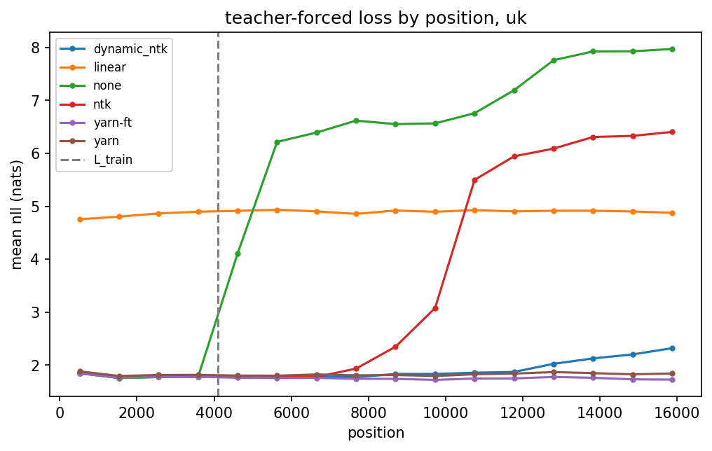 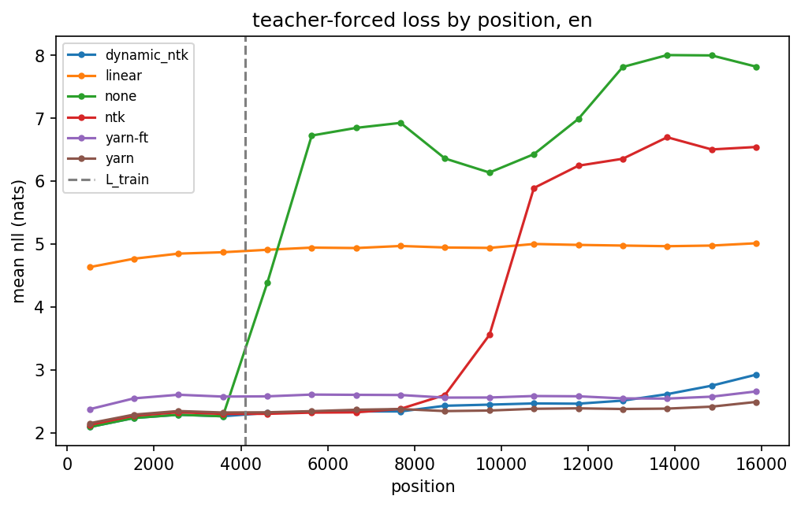

**Bits per byte** on prefixes of each length (lower is better):

| Method | uk 4k | uk 8k | uk 16k | en 4k | en 8k | en 16k |
|---|---|---|---|---|---|---|
| none | 0.467 | 0.989 | 1.460 | 0.874 | 1.639 | 2.211 |
| linear (PI) | 1.261 | 1.263 | 1.281 | 1.883 | 1.887 | 1.905 |
| NTK-aware | 0.471 | 0.470 | 0.925 | 0.889 | 0.891 | 1.520 |
| dynamic NTK | 0.467 | 0.466 | 0.506 | 0.874 | 0.894 | 0.966 |
| YaRN | 0.477 | 0.472 | 0.478 | 0.897 | 0.899 | 0.912 |
| **YaRN + fine-tune** | 0.468 | **0.460** | **0.461** | 0.995 | 0.995 | 0.995 |

- **none:** the loss jumps right after $L_{\text{train}}$, from 1.8 to 6.2 nats by position 5.6k and to ~8 nats by 16k.
- **linear (PI) at s = 4 without training is broken everywhere,** even inside 4k (4.8–4.9 nats from the first bin, uk bpb 1.26 vs 0.47). Squeezing every frequency 4× moves the high-frequency pairs, which encode local order, outside their trained range. Its loss curve is flat but uniformly bad.
- **NTK-aware** holds to ~8k, then breaks: 3.1 nats at 9.7k, 6.4 at 16k. With $b'$ the lowest frequency is divided by 4, but the middle pairs are divided by less, so they still extrapolate past 2× L_train.
- **dynamic NTK** is exact inside 4k (same bpb as none) and degrades slowly: from 1.9 nats at 12k to 2.3 at 16k.
- **YaRN** stays flat to 16k (1.79–1.88 nats). It pays 2.1% bpb inside 4k on uk (0.477 vs 0.467) and 2.6% on en.

### 1.4 Passkey retrieval

Accuracy over 20 keys; each cell lists depth 10 / 50 / 90 %:

| Method | lang | 4k | 8k | 16k |
|---|---|---|---|---|
| none | uk / en | 1 / 1 / 1 | **0 / 0 / 0** | 0 / 0 / 0 |
| linear (PI) | uk / en | **0 / 0 / 0** | 0 / 0 / 0 | 0 / 0 / 0 |
| NTK-aware | uk / en | 1 / 1 / 1 | 1 / 1 / 1 | **0 / 0 / 0** |
| dynamic NTK | uk | 1 / 1 / 1 | 0.95 / 1 / 1 | 1 / 1 / 0.95 |
| dynamic NTK | en | 1 / 1 / 1 | 1 / 1 / 1 | 1 / 1 / 0.90 |
| YaRN | uk / en | 1 / 1 / 1 | 1 / 1 / 1 | 1 / 1 / 1 |
| YaRN + fine-tune | uk / en | 1 / 1 / 1 | 1 / 1 / 1 | 1 / 1 / 1 |

### 1.5 Fine-tune (LongLoRA-style)

| | |
|---|---|
| Start | YaRN, s = 4 |
| Trainable | LoRA r = 8, α = 16 on q, k, v, o (**1.28M**) + embeddings and norms (**131.1M**), as in LongLoRA |
| Data | 800 × 8,192 uk tokens = 6.55M tokens, 1 epoch |
| Optimizer | AdamW; lr 2e-4 (LoRA) and 2e-5 (embeddings and norms); 20 warmup steps, cosine decay to 0.1×; grad clip 1.0 |
| Steps | 200 × grad-accum 4 at sequence length 8,192 |
| Cost | **21 s/step, 70 min** of training; peak memory **9.45 GB** (T4) |

Training loss is noisy: 1.89 at step 0 and 1.87–1.99 over the last steps (`outputs/part1/finetune/train_log.jsonl`).

**Effect** (vs training-free YaRN):
- uk bpb drops by 1.9% at 4k (0.477 → 0.468), 2.4% at 8k and 3.6% at 16k (0.478 → 0.461). The uk curve is now the lowest at every position.
- **English gets worse:** bpb rises from 0.897 / 0.899 / 0.912 to 0.995 at all three lengths (+9–11%). One epoch of Ukrainian data, with the embeddings trainable, moved the model towards Ukrainian at the cost of English.
- Passkey stays at 100%.

### 1.6 KV cache: predicted vs measured

Prediction from the config (fp16): $2\,(\text{K,V}) \times 24\ \text{layers} \times 2\ \text{KV heads} \times 128 \times 2\ \text{B} = 24\ \text{KiB/token}$.

| Length | Predicted | Cache tensors | Allocated increase | Peak increase during prefill |
|---|---|---|---|---|
| 4,096 | 96 MiB | 96 MiB | 96 MiB | 516 MiB |
| 8,192 | 192 MiB | 192 MiB | 192 MiB | 1,032 MiB |
| 16,384 | 384 MiB | 384 MiB | 384 MiB | 2,064 MiB |

- The allocated memory after prefill matches the prediction **exactly** (ratio 1.00). GQA with 2 KV heads makes the cache 4× smaller than with 8 heads.
- The transient peak is 5.4× the cache at every length, so it also grows linearly. It is the prefill's own activations, which are freed afterwards.

### 1.7 Which method we would ship

**Training-free YaRN.** It is the only training-free method that keeps both metrics intact up to 16k: flat loss and 100% passkey in both languages. It costs about 2% bpb inside the original 4k.

The fine-tuned YaRN is 3.6% better on Ukrainian, but it is 9–11% worse on English. It also costs a 70-min run and extra weights (embeddings + norms). We would ship it only for a Ukrainian-only deployment. Dynamic NTK is the fallback if the 4k regime must stay bit-exact, because it equals the base model up to $L_{\text{train}}$.

**Do perplexity and passkey agree?** Mostly yes: none, NTK and YaRN pass and fail at the same lengths in both metrics. They disagree in two places:

1. **Dynamic NTK** gets 90–100% passkey at 16k, while its loss is already rising (bpb +6% over YaRN on uk, +6% on en). Passkey only needs one sharp lookup; it doesn't see a moderate quality drop.
2. **Linear** has a smooth loss curve with no spike at $L_{\text{train}}$, but 0% passkey. A loss curve without a jump doesn't mean the model works; the level matters too.

## Part 2: MoE load balancing

### 2.1 Model used

| | EuroMoE-2.6B-A0.6B-2512 (`MixtralForCausalLM`) |
|---|---|
| Layers / hidden size | 24 / 1024; GQA with 8 query and 2 KV heads, head_dim 128; RoPE θ = 500k; context 4,096 |
| Experts | **64 routed, 0 shared, top-8**; SwiGLU experts with intermediate size 512 |
| Gating | softmax over 64 logits → top-8 → renormalize the 8 weights; router jitter 0 |
| Pretraining balancing (EuroMoE report) | aux load-balancing loss 0.01, computed over the global batch, + router z-loss 0.001 |
| Parameters (counted) | **2.61B total**: experts 2.42B, attention 62.9M, routers 1.57M |
| Active parameters | **0.50B** (0.63B if the tied LM head is counted separately, which matches the published "0.6B") |

### 2.2 Data

**Source.** One shard of Kobza (`Goader/kobza`, file `000_ukr_corpus_00000.parquet`, ~1M documents). All five Kobza sources are interleaved within it. Documents are read in file order until the train split holds 10M tokens.

**Preparation:**
1. NFC normalization; drop documents under 200 characters (359) and exact duplicates (4).
2. **Split by document hash** (md5 mod 1000 → 3% test, 1% val, rest train), so identical texts never cross splits.
3. EuroMoE tokenizer; `[BOS] + doc + [EOS]`, truncated to 2,048 tokens, packed into 1,024-token blocks.
4. **FLORES+** dev + devtest: 2,009 aligned uk/en sentences, padding masked. **None of them appear in train.**

| Split | Docs | Tokens | 1,024-token blocks | Used for |
|---|---|---|---|---|
| train | 14,424 | 10,000,213 (5.0M used) | 9,765 | gradients only |
| val | 139 | 105,197 | 102 | validation PPL every 100 steps |
| test | 442 | 321,938 | 314 | main table: PPL and routing |
| FLORES uk / en | 2,009 / 2,009 | 81,644 / 56,342 predicted | — | language comparison, English forgetting |

**Tokenizer fertility** (FLORES): uk 2.17 tokens/word (40.6 per sentence), en 1.32 (28.0 per sentence). The same content costs 1.45× more tokens in Ukrainian. We therefore compare languages by **total NLL per sentence**, not per-token perplexity. Kobza is built from web crawls that probably overlap EuroMoE's pretraining data; this affects all runs equally.

### 2.3 Instrumentation and metrics

**Instrumentation.** We replace each layer's router with a subclass of `MixtralTopKRouter`. It stores its logits and selected experts, and can optionally select experts with a bias. With the bias off, it reproduces the original model exactly (max abs logit difference **0.0**).

**Metrics.** For one layer, with $T$ tokens, $N = 64$ experts, $k = 8$, logits $\ell(x)$, probabilities $p(x) = \mathrm{softmax}(\ell(x))$ and selected set $S(x)$:

$$f_i = \frac{1}{Tk}\sum_x \mathbf 1[i\in S(x)],\qquad \mathrm{MaxVio} = \frac{\max_i c_i - \bar c}{\bar c} = N\max_i f_i - 1,\qquad H = -\frac{\sum_i f_i\log f_i}{\log N},\qquad \mathrm{LSE} = \frac1T\sum_x \log\sum_j e^{\ell_j(x)}$$

- MaxVio ranges from 0 (perfect balance) to $N/k - 1 = 7$ (one expert in the top-8 of *every* token).
- **Routing drift** is the mean Jaccard overlap between the base and the trained top-8 sets on the same tokens.
- **Language difference** is the Jensen–Shannon divergence between the uk and en load distributions per layer (base 2, range 0–1).

**Noise floor** (uniform random top-8 router, 1,000 draws at the same token count):

| Set | Tokens | MaxVio per layer, mean (p95) | Max over 24 layers, mean (p95) |
|---|---|---|---|
| training batch | 8,192 | 0.070 (0.093) | 0.099 (0.119) |
| UA test | 321,536 | 0.011 (0.014) | 0.015 (0.018) |
| FLORES uk / en | 83,653 / 58,351 | 0.022 / 0.026 | 0.030 / 0.038 |

### 2.4 Base model

- **UA test:** perplexity 7.516, mean MaxVio **5.70** (max over layers 6.96), entropy 0.881. That is about **500× the random-router floor** (0.011).
- **English is much more balanced:** on FLORES en, MaxVio is 1.52 and entropy 0.952, vs 5.46 and 0.878 on FLORES uk.
- **Per sentence, Ukrainian costs more:** total NLL 112.4 vs 88.7 nats.

| Layers | MaxVio | Entropy | Overloaded experts (> 2× mean) | Rarely used experts (< 0.5× mean) |
|---|---|---|---|---|
| early 0–7 | 4.79 | 0.909 | 4.8 | 17.1 |
| middle 8–15 | 5.67 | 0.926 | 5.1 | 14.5 |
| late 16–23 | **6.64** | 0.809 | 7.6 | **31.5** |

- Layers 0 and 20–23 have MaxVio of 6.7–7.0, close to the maximum of 7. One expert there is in the top-8 of **~99% of tokens**, so it acts as a de facto shared expert.
- Layers 6–7 are the most balanced (MaxVio 1.3–1.7).
- The uk/en difference is **U-shaped**: JS divergence is 0.18 in early layers, 0.10 in middle layers and 0.41 in late layers, with 0.56 at layer 0 and 0.80 at layer 23.

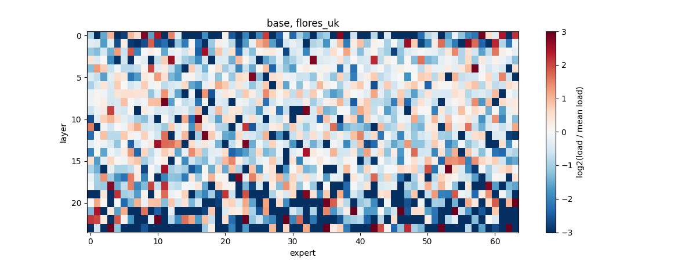 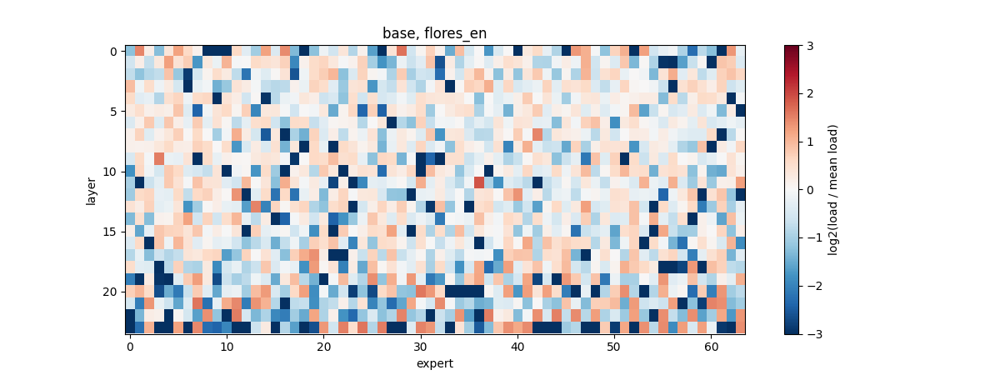

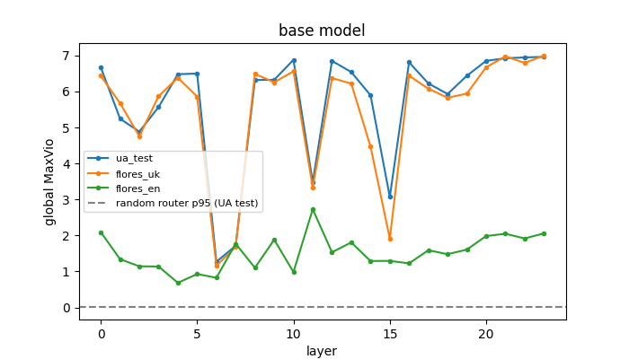 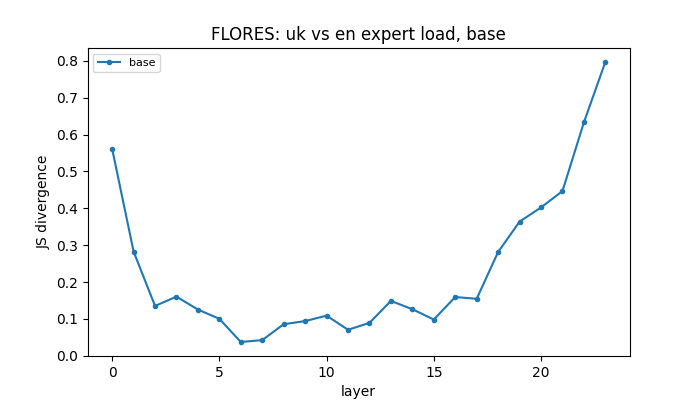

### 2.5 Training

**What is trained.** Attention (q, k, v, o) and the routers are trained: 64.5M parameters, kept in fp32. The experts, embeddings and norms are frozen in fp16. Full fine-tuning with AdamW would need ~42 GB; this setup peaks at **9.4 GB** on a 15 GB T4.

**Objective.** $\mathcal L = \mathcal L_{\text{LM}} + \alpha\sum_{l=1}^{24}\mathcal L_{\text{aux}}^{(l)} + \beta\sum_{l=1}^{24}\mathcal L_{z}^{(l)}$, with these terms:

- **Auxiliary load-balancing loss** (Switch / GShard, in paper form):
  $$\mathcal L_{\text{aux}}^{(l)} = N\sum_{i=1}^{N} f_i\,P_i,\qquad P_i = \frac1T\sum_x p_i(x)$$
  - $f_i$ is a count and carries no gradient; the gradient reaches the router through $P_i$.
  - The loss equals **1 at perfect balance**. It is summed over layers, so each router receives the paper-form gradient α.
  - $f_i$ is computed from the expert counts of the whole optimizer step so far (all micro-batches), not one micro-batch. This is global-batch balancing, as in EuroMoE's pretraining (Qiu et al., 2025).
  - *Check against HF.* `load_balancing_loss_func` equals $k$ at balance and pools all layers into one distribution. On the same batch it gives 8.40, against our per-layer mean of 2.03, a ratio of 4.1 rather than 8. Pooling across layers hides per-layer imbalance, because different layers overload different experts.
  - *Assignment check.* With the coefficient passed to `from_pretrained`, the HF aux loss is non-zero, and $\mathcal L(0.02) - \mathcal L(0.01) = 0.01\cdot\mathcal L_{\text{aux}}$ (ratio 1.000002). Changing `config.router_aux_loss_coef` after loading leaves the loss unchanged (2.27755 in both cases). For training, the HF aux loss is disabled and only ours is used.
- **Router z-loss** (ST-MoE): $\mathcal L_z^{(l)} = \frac1T\sum_x\big(\log\sum_j e^{\ell_j(x)}\big)^2$.
- **Auxiliary-loss-free bias** (Wang et al., 2024):
  - Selection uses $S(x) = \mathrm{TopK}(\ell(x) + b,\,k)$.
  - Gate weights come from the **unbiased** softmax, $g_i = p_i/\sum_{j\in S(x)}p_j$.
  - After every optimizer step, $b_i \leftarrow b_i + \gamma\,\mathrm{sign}(\bar c - c_i)$, using that step's counts.
  - $b$ is a float32 buffer outside the optimizer, added to the logits.
  - γ = 1e-3, chosen before training. The bias can move at most γ·610 = 0.61 per run, about 10× the median gap between the 8th and 9th logit (0.061).

| Run | Strategy | α (aux) | β (z) | Bias | Router trained | Seeds |
|---|---|---|---|---|---|---|
| A | no balancing (control) | 0 | 0 | off | yes | 42, 43 |
| B | aux, weak | 1e-3 | 0 | off | yes | 42 |
| C | aux, strong | 1e-2 | 0 | off | yes | 42 |
| D | bias (aux-loss-free) | 0 | 0 | γ = 1e-3 | yes | 42, 43 |
| E | frozen router | 0 | 0 | off | **no** | 42 |
| F | aux + z-loss | 1e-3 | 1e-3 | off | yes | 42 |

**Constants, identical for every run** (`config.yaml` → `part2.train`):

| | |
|---|---|
| Sequence length | 1,024 |
| Batch | micro-batch 2 × gradient accumulation 4 = **8,192 tokens/step**. Micro-batch 4 runs out of memory. |
| Token budget | **4,997,120 tokens = 610 steps** |
| Optimizer | AdamW, β = (0.9, 0.95), weight decay 0, gradient clipping 1.0 |
| Learning rate | 3e-5 (attention and router), 30 warmup steps, cosine decay to 3e-6 |
| Precision | fp16 autocast + GradScaler; gradient checkpointing with `use_reentrant=False` |

### 2.6 Training curves (W&B)

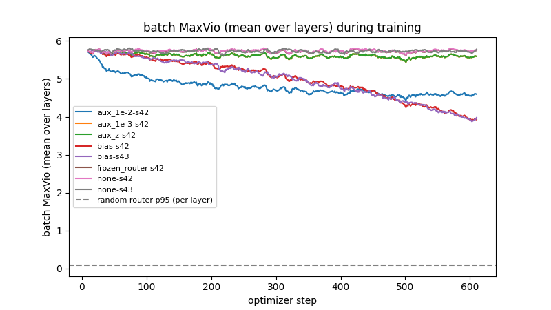 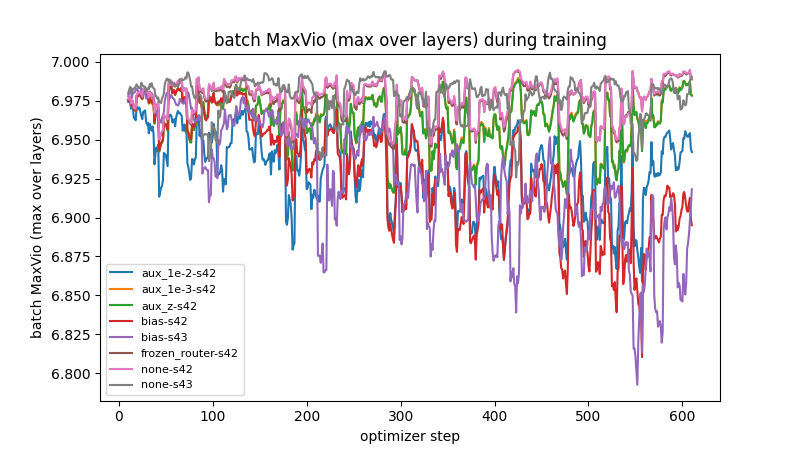

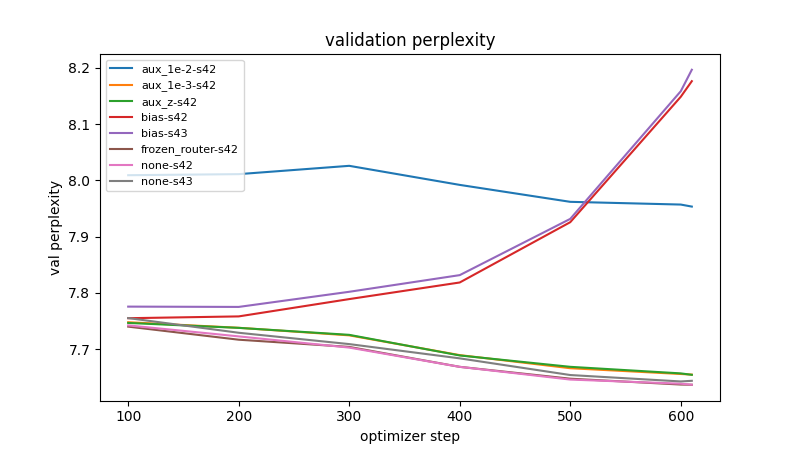 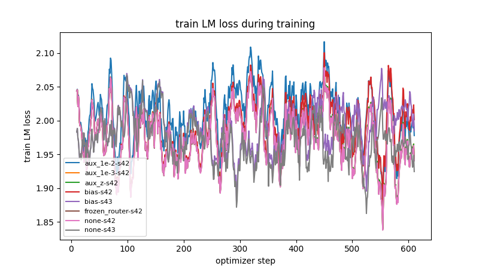

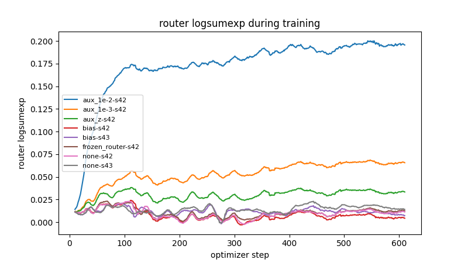 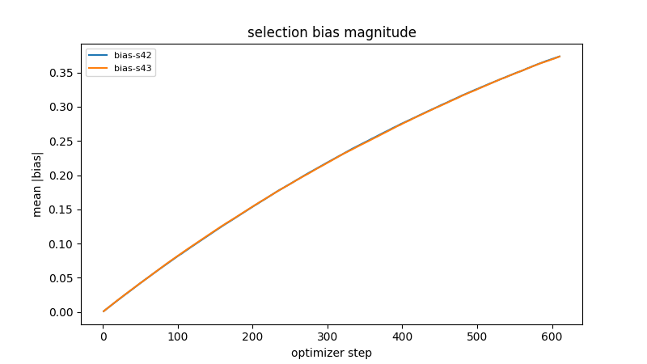

### 2.7 Results

**Main table** (UA test; the drift columns give the Jaccard overlap with the base model's top-8, where 1 = unchanged):

| Run | UA PPL | Δ PPL vs A | Mean MaxVio | Max MaxVio | Entropy | LSE | Drift UA | Drift EN | FLORES-en PPL | NLL/sent uk | NLL/sent en | JS uk/en |
|---|---|---|---|---|---|---|---|---|---|---|---|---|
| base | 7.516 | +3.4% | 5.70 | 6.96 | 0.881 | 0.014 | 1 | 1 | 23.65 | 112.4 | 88.7 | 0.229 |
| **A** none (s42 / s43) | 7.272 / 7.273 | — | 5.73 / 5.72 | 6.97 | 0.880 | 0.011 / 0.014 | 0.914 | 0.863 | 25.31 / 24.85 | 105.7 | 90.6 / 90.1 | 0.210 |
| B aux 1e-3 | 7.291 | +0.3% | 5.57 | 6.96 | 0.898 | 0.066 | 0.872 | 0.855 | 25.43 | 105.7 | 90.8 | 0.210 |
| C aux 1e-2 | 7.567 | +4.1% | 4.57 | 6.91 | 0.939 | 0.196 | 0.718 | 0.814 | 25.86 | 106.7 | 91.2 | 0.187 |
| **D** bias (s42 / s43) | 7.725 / 7.734 | **+6.3%** | **3.89 / 3.89** | 6.87 | **0.948** | 0.004 / 0.007 | **0.635** | 0.708 | 25.49 / 24.83 | 112.5 / 112.9 | 90.8 / 90.1 | 0.192 |
| E frozen router | 7.273 | +0.0% | 5.72 | 6.97 | 0.880 | 0.013 | 0.926 | 0.872 | 25.13 | 105.7 | 90.4 | 0.210 |
| F aux + z | 7.291 | +0.3% | 5.57 | 6.96 | 0.898 | 0.033 | 0.873 | 0.854 | 25.52 | 105.7 | 90.9 | 0.210 |
| random router, mean (p95) | — | — | 0.011 (0.014) | 0.015 (0.018) | — | — | — | — | — | — | — | — |

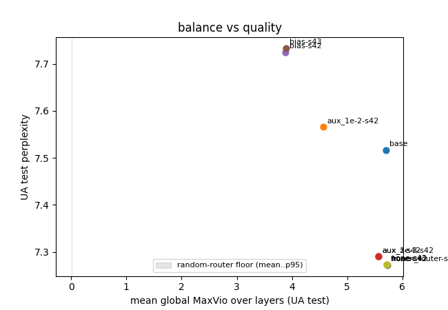

*Balance vs quality: one dot per run, both seeds shown. The random-router floor is at x ≈ 0.01, on the left edge.*

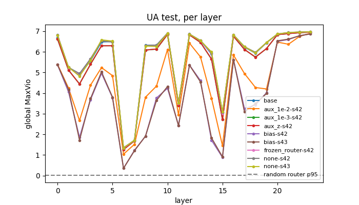 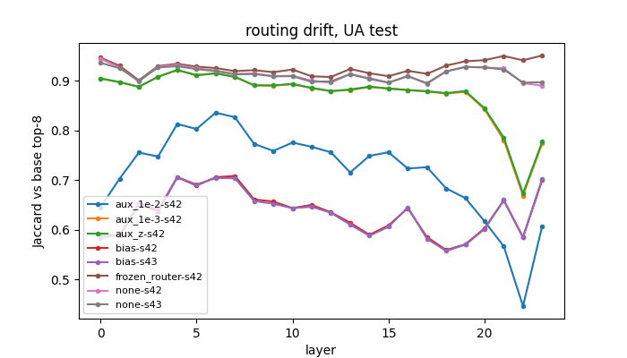

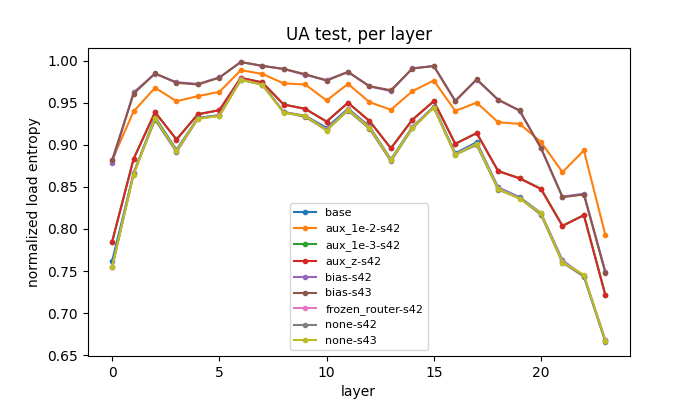 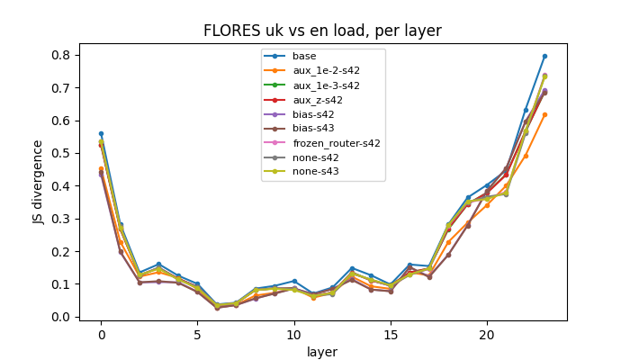

**Heatmaps after training** (UA test, same scale as the base heatmap above):

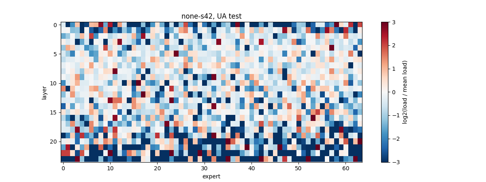 

 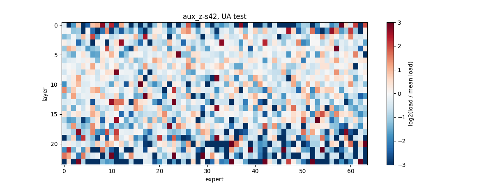

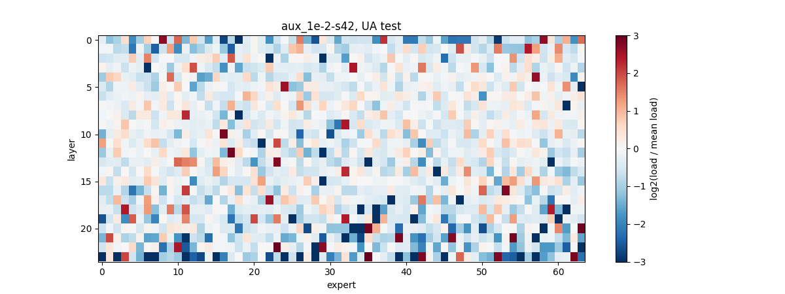 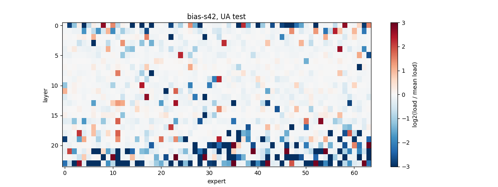

 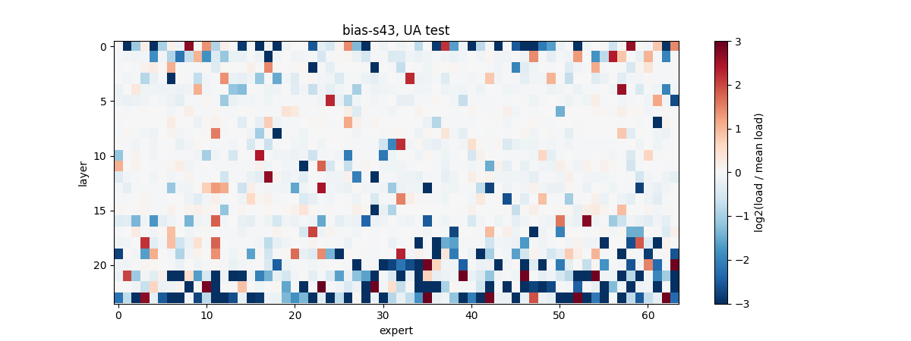

**Comparisons**

1. **Base vs A (effect of training alone).** UA perplexity improves by 3.2% (7.516 → 7.272), and Ukrainian NLL per sentence drops from 112.4 to 105.7. Balance does **not** get worse: MaxVio goes from 5.70 to 5.72–5.73. English is partly forgotten: FLORES-en perplexity rises from 23.65 to 24.85–25.31.
2. **A vs B / C / D (effect of balancing, the main result).** Balance improves in the order B < C < D (−3%, −20%, −32% mean MaxVio; entropy 0.898 / 0.939 / 0.948), and perplexity gets worse in the same order (+0.3%, +4.1%, +6.3%). In both C and D, each 1.0 drop in MaxVio costs about 0.25 perplexity (C: −1.16 for +0.30; D: −1.84 for +0.46), so they sit on roughly one trade-off line. D's per-sentence NLL on FLORES uk (112.5–112.9) is back at the base level: in that metric, D cancelled the whole gain from training.
3. **C vs D.** D balances more (3.89 vs 4.57) and moves routing further from the base (Jaccard 0.635 vs 0.718). It doesn't inflate the router logits (LSE 0.004 vs 0.196), but it costs more perplexity (7.73 vs 7.57). C reached its balance in ~200 steps and then stayed put. D was still changing at the end (§2.6), so a longer run would give D more balance and probably more cost.
4. **A vs E (router learning vs attention-induced drift).** With the router frozen, 7.4% of top-8 choices still change (Jaccard 0.926), against 8.6% in A (0.914). Most of A's drift comes from attention changing the router's input, not from the router learning.
5. **UA vs EN.** Training brings uk and en routing slightly closer (JS 0.229 → 0.210); balancing brings them closer still (C 0.187, D 0.192). On English the strategies differ by less than the seed spread: FLORES-en perplexity is 24.83–25.86, while A's two seeds alone differ by 0.46.
6. **Seeds.** For A and D, the second seed changes UA perplexity by 0.001 and 0.009, and MaxVio by 0.010 and 0.002. The C and D effects (+0.30 and +0.46 perplexity) are 30–50× larger than the larger of these. B's +0.019 is only 2–19× the seed spread, so with one seed it is the least certain result.
7. **The z-loss** (F vs B) halves the router logsumexp (0.066 → 0.033) and changes nothing else measurable.
8. **The late layers stay unbalanced.** Max-over-layers MaxVio is 6.87–6.97 for *every* run. Balancing helps the early and middle layers most: under D, layer 6 drops to 0.4 and layers 2, 8 and 14 to 1.7–1.9. Layers 20–23 stay at 6.5–6.9 under every strategy.

**Which strategy balances best, and what does it cost?** The bias update balances best: mean MaxVio −32%, the highest entropy, and the same result on both seeds. It costs the most: +6.3% UA perplexity (worse than the untrained base), and its validation perplexity was still rising when training ended. The aux loss at 1e-2 gives two-thirds of that improvement for two-thirds of the cost. At 1e-3 it is nearly free and does almost nothing. With experts frozen and a 5M-token budget, **no strategy gave balance without a perplexity cost.** A likely reason, which we did not measure, is that balancing redirects Ukrainian tokens to experts that cannot adapt, because the experts are frozen.

### 2.9 Failure cases and negative results

- **D did not converge.** The sign rule moves each bias by exactly γ per step, so 610 steps cap the bias at 0.61. That cap was reached, and both MaxVio and the perplexity cost were still changing at the end. A longer run, or a larger γ, would be needed to see D's end state.
- **No strategy fixes the late-layer "shared" experts** (MaxVio ≈ 6.9 in layers 20–23).
- **The z-loss at 1e-3 had no effect** on balance or perplexity; it only reduced the logsumexp.
- **Limited replication.** B, C, E and F have one seed each, and the budget is only 5M tokens with frozen experts. The effects are smaller than in full continued pretraining would likely be, and the trade-off may look different when experts can adapt.
- **Inference precision.** The model was pretrained in bf16 and run in fp16 on the T4. No non-finite values appeared in any run.

## Part 3: MixLoRA (bonus)

W&B: [`ai500-lab1-part3`](https://wandb.ai/ai340-nlp/ai500-lab1-part3). Notebooks: `notebooks/lab1-part3.ipynb` (first 6 runs), `notebooks/lab1-part3-v2.ipynb` (larger test set, re-evaluation, extra seeds and γ).

### 3.1 Setup

**Model:** Qwen2.5-1.5B-Instruct (28 layers), bf16 weights frozen.

**Task:** Spivavtor GEC (`task = gec`).
- train 4,000 / val 300 from the train split; test from the validation split.
- Examples over 256 tokens are dropped, not truncated. After filtering, **1,476** test examples remain.
- Splits are checked to be disjoint. The loss is computed on the answer only (prompt masked; the check is printed in the notebook).

**MixLoRA** (`src/lab1/part3/mixlora.py`):
- 8 LoRA experts on gate / up / down in every MLP, sharing the frozen MLP weights.
- top-2 softmax router; the 2 weights are renormalised.
- plain LoRA on q / k / v / o. Rank 16, α = 32 everywhere.

**Balancing:** reuses Part 2:
- aux loss (coefficient 1e-2, per layer, paper form);
- bias update with sign rule, γ = 1e-3 (as in Part 2) and γ = 1e-2;
- no balancing.

**Baselines:**
- LoRA r = 16 on all 7 projections;
- r = **102**, matched to MixLoRA's trainable parameters (117.7M vs 117.6M);
- r = **29**, matched to its active parameters per token (33.5M vs 32.9M).

Ranks come from `Adapter.matched_rank`.

**Training is identical for every run:**
- 250 steps × (micro-batch 8 × grad-accum 2) = 1 epoch;
- AdamW, lr 2e-4, 20 warmup steps, cosine decay to 0.1×;
- seed 42 for data order and init.

**Checks (fp32, notebook output):**
- the fresh adapter reproduces the base logits (max diff 1.9e-4 for MixLoRA, 0 for LoRA);
- the trainable count equals the formula;
- save/load round-trip is exact.

**Metrics:**
- **Main:** word-level edit **F0.5**. Edits come from difflib alignment of source→hypothesis vs source→reference.
- 95% paired bootstrap CI (1,000 resamples) and the difference to LoRA r = 102.
- chrF and exact match (EM), on all examples and on the 55% that need a correction (`_changed`).
- validation loss.

### 3.2 Results

| Run | F0.5 [95% CI] | Δ vs LoRA-r102 [95% CI] | P / R | EM (changed) | val loss | Trainable / active | s/step | Peak GB | val MaxVio mean / max |
|---|---|---|---|---|---|---|---|---|---|
| base (no tuning) | 0.017 | −0.397 | 0.015 / 0.053 | 0.001 | 0.403 | 0 | — | — | — |
| copy input | 0 | −0.414 | — | 0 | — | — | — | — | — |
| LoRA r16 | 0.392 [0.359, 0.424] | −0.023 [−0.041, −0.004] | 0.447 / 0.262 | 0.144 | 0.177 | 18.5M | 2.36 | 4.34 | — |
| LoRA r29 (active-matched) | 0.405 [0.372, 0.438] | −0.010 [−0.029, +0.010] | 0.464 / 0.267 | 0.150 | 0.175 | 33.5M | 2.47 | 4.57 | — |
| **LoRA r102** (param-matched) | **0.415** [0.383, 0.448] | 0 | 0.467 / 0.288 | 0.161 | **0.171** | 117.7M | 2.59 | 5.83 | — |
| MixLoRA, none | 0.406 [0.375, 0.440] | −0.008 [−0.029, +0.012] | 0.465 / 0.269 | 0.150 | 0.175 | 117.6M / 32.9M | 4.38 | 7.64 | 1.74 / 2.56 |
| MixLoRA, aux 1e-2 | 0.391 [0.360, 0.425] | −0.024 [−0.044, −0.005] | 0.441 / 0.269 | 0.150 | 0.175 | 117.6M / 32.9M | 4.29 | 7.62 | **0.05** / 0.10 |
| MixLoRA, bias γ=1e-3 | 0.399 [0.367, 0.432] | −0.016 [−0.035, +0.004] | 0.451 / 0.273 | 0.154 | 0.175 | 117.6M / 32.9M | 4.33 | 7.61 | 0.95 / 2.28 |
| MixLoRA, bias γ=1e-2 | 0.398 [0.366, 0.433] | −0.016 [−0.036, +0.004] | 0.455 / 0.267 | 0.142 | 0.175 | 117.6M / 32.9M | 4.18 | 7.54 | **0.06** / 0.15 |
| *seed 43:* MixLoRA, none | 0.375 [0.342, 0.407] | −0.040 [−0.060, −0.020] | 0.414 / 0.273 | 0.132 | 0.175 | — | 4.26 | 7.57 | 1.68 / 2.51 |
| *seed 43:* LoRA r102 | 0.374 [0.344, 0.407] | −0.040 [−0.060, −0.023] | 0.400 / 0.298 | 0.134 | 0.173 | — | 2.77 | 5.78 | — |

MaxVio for 8 experts with top-2 ranges from 0 to $N/k - 1 = 3$.

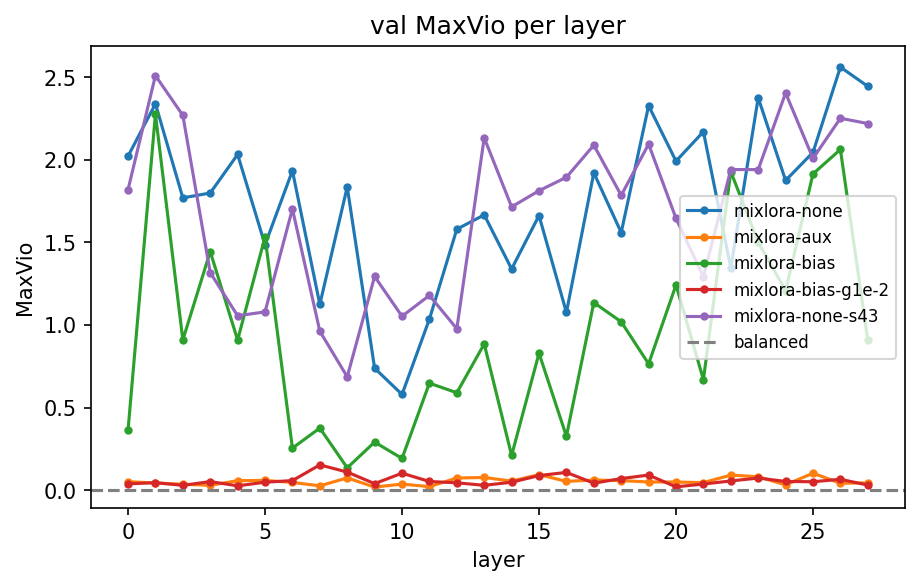 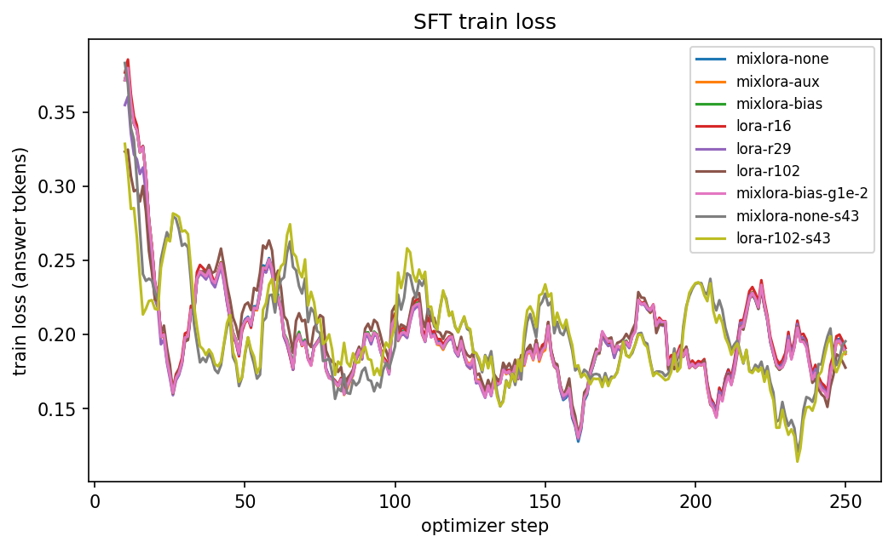

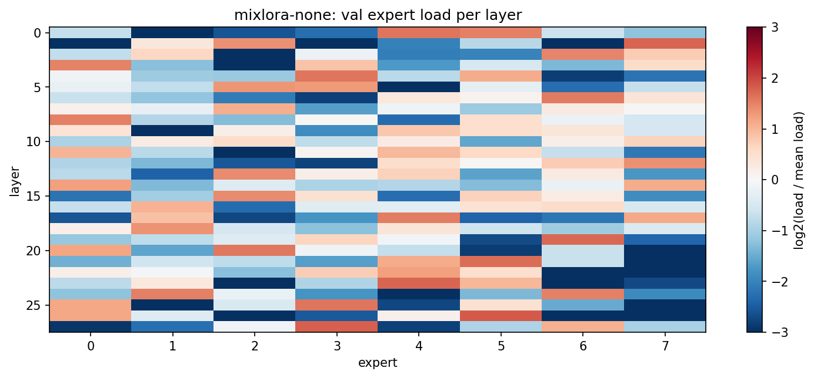 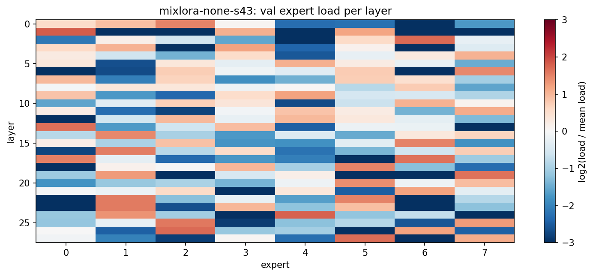

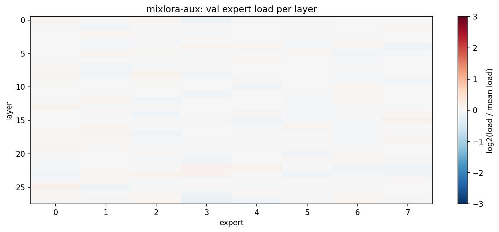 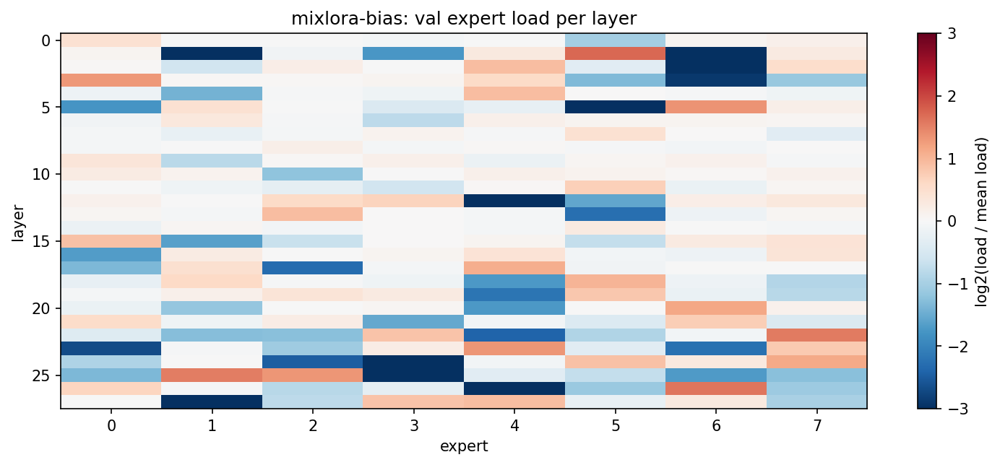

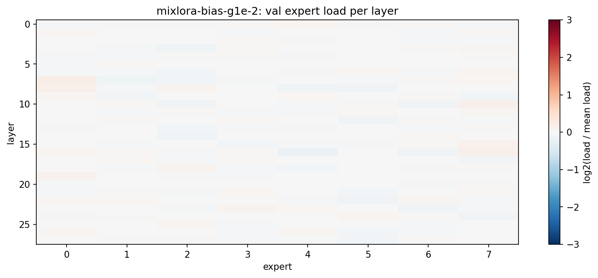

**chrF and full-set EM don't separate the systems.** Copying the input gives chrF 93.19 and EM 0.446, above or equal to every trained model (92.3–93.1, 0.41–0.45), because 45% of the test sentences need no change. We therefore rank by edit F0.5. For EM we use only the sentences that need a correction.

### 3.3 Does the mixture beat a parameter-matched LoRA?

**No.**

- **Quality:** MixLoRA without balancing reaches F0.5 0.406 vs 0.415 for LoRA r102. The difference is −0.008, with a CI of [−0.029, +0.012] that contains 0.
- **Seeds:** with seed 43 both models fall to the same 0.375 / 0.374. The seed effect (−0.03 to −0.04) is 4× larger than the MixLoRA vs LoRA gap, so on this task the two are indistinguishable.
- **Active-matched LoRA:** r29 (0.405) matches MixLoRA too, with 3.5× fewer trainable parameters.
- **Cost:** MixLoRA is **1.7× slower per step** (4.2–4.4 vs 2.6 s) and uses **+1.8 GB** peak memory (7.6 vs 5.8 GB). Our MixLoRA uses a Python loop over the 8 experts, not a fused kernel, so part of the extra time may come from the implementation.
- **Inference:** unlike LoRA, MixLoRA cannot be merged into the base weights.

Balancing changes neither validation loss (0.175 for all MixLoRA runs) nor F0.5 beyond its CI. aux 1e-2 is the only variant whose CI vs r102 excludes 0 (−0.024), but its CI overlaps MixLoRA-none's.

### 3.4 What happens to the router without balancing

The router **concentrates but does not collapse**.

- **Imbalance:** val MaxVio averages 1.74 over 28 layers, with a maximum of 2.56; the ceiling is 3.
- **Underused experts:** 16 of 224 layer-expert slots get less than 10% of the mean load.
- **Seed 43:** the imbalance is about the same: MaxVio 1.68 / 2.51 and 23 slots under 10%. The per-layer pattern differs between the two seeds (see the MaxVio plot).
- **Quality:** the imbalance doesn't hurt. The unbalanced run has the best MixLoRA F0.5.

**The remedies:**
- **aux 1e-2** balances almost perfectly: MaxVio 0.05.
- **bias γ = 1e-3**, the Part 2 value, only halves the imbalance (0.95). The sign rule moves each bias by exactly γ per step, so in 250 steps it can move at most 0.25, and that was not enough. Same failure as in Part 2 (§2.9).
- **bias γ = 1e-2** reaches 0.06, as good as aux, with no gradient through the router.

### 3.5 Failure cases and negative results

- MixLoRA brings no quality gain at a 1.7× time cost. Every MixLoRA vs LoRA difference is within one seed's spread.
- Only the key pair (MixLoRA-none, LoRA-r102) has 2 seeds. The other rows are single-seed.
- In the first run (`lab1-part3.ipynb`), adapter initialization was not seeded. In v2 the six seed-42 adapters were **re-evaluated, not retrained**, on the larger test set. Only the γ = 1e-2 and seed-43 runs were trained in v2, with seeded init.
- GEC on Spivavtor is close to copying: about half of the test set needs no edit. Recall stays at 0.26–0.30 for every adapter, so the models under-correct.

## Prediction-error table

## Failure cases and negative results

## Contributions

## AI tools disclosure
