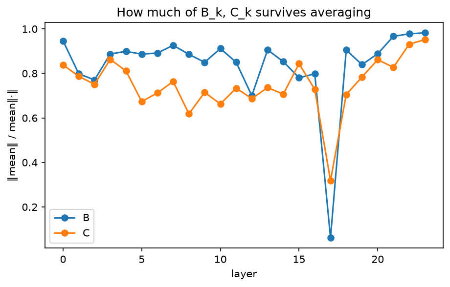
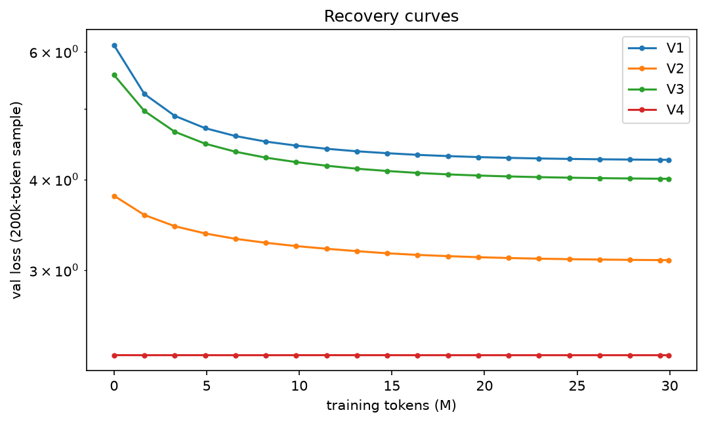

# Part 1: selection variants of mamba-130m

## Pre-registered prediction (written before the zero-shot V1–V3 evaluation)

Variants (static = replaced by its calibration average, frozen input-independent):

| variant | Δ | B | C |
|---|---|---|---|
| V1 | static | static | static |
| V2 | selective | static | static |
| V3 | static | selective | static |
| V4 | selective | selective | selective (stock model) |

**Predicted zero-shot English perplexity ordering (best → worst): V4 < V2 < V3 < V1.**

Reasoning:
- V4 is the unmodified pretrained model, so it is best by construction.
- V1 removes all input dependence at once, so it is worst.
- Between V2 and V3: Δ controls how much the state is reset or kept per token (the gating role),
  and the Mamba paper names it the most important selective parameter. Without it, a pretrained
  model loses its ability to forget/ignore tokens. So keeping a selective Δ (V2) should hurt less than
  keeping only a selective B (V3). This matches the Table 7 ordering (V4 8.71 < V2 9.81 < V3 10.15 < V1 10.93),
  although Table 7 trains from scratch and here the surgery is zero-shot on a pretrained model.
- Expected gap size: the zero-shot gaps should be much larger than in Table 7 (perplexities far above 10.56
  for V1–V3), because the rest of the network was co-adapted to input-dependent Δ/B/C. Recovery training
  should close most of the gap and move the ordering closer to Table 7.

## 1.1 Setup

W&B: [`ai500-lab2-part1`](https://forge.coreweave.com/wandb/ai340-nlp/ai500-lab2-part1). Notebook: `notebooks/lab2-part1.ipynb`
(run top to bottom; its outputs are the tests deliverable). Code: `src/lab2/part1/`.

- **Model:** `state-spaces/mamba-130m-hf`, 24 layers, d_model 768, d_inner 1,536, state N = 16, Δ rank 48. 129.1M parameters.
- **Hardware / software:** 1× NVIDIA H100 NVL; torch 2.10.0+cu128 (CUDA 12.8), transformers 5.23.0,
  mamba-ssm 2.3.2.post1, causal-conv1d 1.7.0 (prebuilt wheels, Route B), Python 3.13.
- **Eval data** (seed 42, built once and reloaded):
  - English: Pile test (`monology/pile-uncopyrighted`), 2,788 docs, 2.00M tokens;
  - Ukrainian: Kobza shard `001_ukr_corpus_00000`, 1,921 docs, 2.00M tokens; never trained on;
  - val: Pile val, 294 docs, 200k tokens.

  Each doc is cut to 2,048 tokens with an EOS prefix; docs shorter than 200 characters are dropped,
  shorter docs are kept whole (2,381 of 2,788 English docs are shorter than 2,048 tokens).
  Rebuilding val with the same seed gives identical ids.
- **Train data:** Pile train shard `00`, packed into 2,048-token rows, fixed order per seed. 488 rows (~1M tokens) for
  calibration, 14,648 rows (30M tokens) for training. **No eval doc** (en / uk / val) appears in the calibration or training stream (md5 of the text).
- **Metrics:** fp32, eval mode, `use_cache=False`, one doc per forward. ppl = exp(total NLL / total tokens),
  bpb = total NLL / ln 2 / total UTF-8 bytes (needed because en and uk tokenise differently).

## 1.2 Variants and checks

`SelectiveMixer` (`variants.py`) swaps the class of every `MambaMixer` in place:

- **Static Δ:** `dt_proj.weight` is zeroed and frozen, so Δ = softplus(β) per channel. β (= `dt_proj.bias`) is initialised
  from calibration and stays trainable.
- **Static B / C:** a trainable fp32 (d_inner, N) parameter `B_static` / `C_static`, initialised from the calibration mean
  and passed to the kernels as an input-independent B / C. The corresponding `x_proj` rows are no longer used.
- **Paths:** the train branch calls the fused `mamba_inner_fn`, the eval branch calls `causal_conv1d_fn` + `selective_scan_fn` directly.

| Check | Result | Tolerance |
|---|---|---|
| **CP2:** V4 vs stock logits, fp32 eval | max abs diff **0.0** | < 1e-3 |
| **CP3:** train-mode vs eval-mode logits, same unpadded batch (2 × 1,024) | **0.0** for V1–V4 | fp32 rounding |
| Static quantities invariant to input (two random inputs, every layer) | static: diff 0.0; selective Δ: 88.3, selective B: 40.4 | static == 0 |
| Gradient reproducibility, two fp16-autocast backward passes (conv1d / x_proj) | max rel diff V1 0.0, V2 0.0, V3 6.2e-4 | 1e-3 |
| `dt_proj.weight` still zero after training (V1, V3) | yes (asserted at the end of every run) | — |

CP3 is exactly 0, not just at rounding level. This is not a missed train path: during the checks the kernel counter
recorded 240 `mamba_inner_fn` and 120 `selective_scan_fn` calls. In fp32 both paths launch the same kernels in the same order.

**CP4, kernel counts.** Every training run used only the fused path and every eval only the scan path; there were **0 fallback calls** anywhere
(`figures/part1/kernel_counts.md`). Each full run: 43,872 fused calls (457 steps × 4 micro-batches × 24 layers) and
134,064 conv / scan calls (19 val evals × 294 docs × 24 layers; the step-0 val eval runs before the counter starts).

**Parameter counts:**

| | total | trainable | note |
|---|---|---|---|
| V4 | 129,135,360 | 129,135,360 | stock |
| V1 | 130,315,008 | 128,545,536 | + B_static, C_static; − frozen `dt_proj.weight` (1.77M) |
| V2 | 130,315,008 | 130,315,008 | + B_static, C_static (2 × 24 × 1,536 × 16 = 1.18M) |
| V3 | 129,725,184 | 127,955,712 | + C_static; − frozen `dt_proj.weight` |

The unused `x_proj` rows for static B / C stay in the model and count as trainable but receive no gradient (only weight decay).
So "trainable" overstates V1–V3 by up to 2 × 16 × 1,536 × 24 = 1.18M. <!-- TODO: subtract them, or freeze the rows. -->

## 1.3 Baseline (CP1)

| | ppl | bpb |
|---|---|---|
| English (Pile test) | **9.751** | 0.804 |
| Ukrainian (Kobza) | 9.21 | 1.056 |

The published value is 10.56, so we are **0.81 lower (−7.7%)**. We do not treat this as a bug, because a broken path would raise ppl, not lower it,
and CP2–CP4 pass. Likely causes:
- our sample comes from `pile-uncopyrighted` (no Books3 and other removed subsets) and from the test split;
- 85% of the docs are shorter than 2,048 tokens;
- docs under 200 characters are dropped.

## 1.4 Calibration

The ratio ‖mean B_k‖ / mean ‖B_k‖ over ~1M tokens measures how much of B (or C) survives averaging; 1 means B does not depend on the input.
- Most layers: 0.70–0.98 for B and 0.62–0.95 for C, so the mean keeps most of the direction.
- C loses more than B in almost every layer.
- **Layer 17 is the outlier: B 0.061, C 0.318.** There B points in different directions for different tokens, and its average is close to 0.
  A static B in this layer writes almost nothing into the state.
- The last layers (21–23) are almost static already (0.93–0.98).

## 1.5 Zero-shot surgery

| Variant | Δ / B / C | En ppl | En bpb | Uk bpb | Table 7 (350M, from scratch) |
|---|---|---|---|---|---|
| V4 | sel / sel / sel | **9.751** | 0.804 | 1.056 | 8.71 |
| V2 | sel / static / static | 44.75 | 1.341 | 2.114 | 9.81 |
| V3 | static / sel / static | 250.4 | 1.949 | 3.654 | 10.15 |
| V1 | static / static / static | 427.9 | 2.138 | 4.225 | 10.93 |

- **The ordering V4 < V2 < V3 < V1 matches the prediction and Table 7.**
- **The gaps are far larger than in Table 7.** V1 is 44× worse than V4 here vs 1.25× in Table 7. Table 7 trains every variant from scratch;
  here the rest of the network was trained to work with input-dependent Δ / B / C and has no time to adapt.
- **Δ matters most.** Starting from all-static V1, making only Δ selective (V2) cuts ppl 9.6× (428 → 45);
  making only B selective (V3) cuts it 1.7× (428 → 250).
- Ukrainian shows the same ordering, and the bpb gaps are similar to English.

## 1.6 Recovery training (CP5)

**Hyperparameters:**
- AdamW, betas (0.9, 0.95), weight decay 0.1 (none on biases, norms, A_log, D, β, B_static, C_static), grad clip 1.0;
- fp16 autocast + GradScaler, fp32 weights;
- micro-batch 8 × grad accum 4 × 2,048 = 65,536 tokens per step, 457 steps = 29.95M tokens;
- warmup 2% (9 steps), then cosine to 0.1 × lr;
- val every 25 steps on the 200k sample;
- same rows, order, seed and config for every variant.

**CP5 forced lr = 1e-5.** The configured lr of 3e-4 made V4 worse, and so did every lr we tried down to 3e-5
(V4 English ppl after 30M tokens, baseline 9.751):

| lr | V4 En ppl | val loss start → max → end | CP5 |
|---|---|---|---|
| 3e-4 | 10.050 | 2.2915 → 2.347 → 2.322 | ✗ |
| 1e-4 | 9.841 | 2.2915 → 2.308 → 2.301 | ✗ |
| 3e-5 | 9.770 | 2.2915 → 2.294 → 2.293 | ✗ |
| **1e-5** | **9.750** | 2.2915 → 2.2915 → 2.2912 | ✓ |

The pretrained model already sits at its optimum on this data. A fresh AdamW at any lr well above the end of pretraining's schedule
throws it out in the first ~1.5M tokens (the val loss jumps), and 30M tokens is not enough to come back. The 3e-4 and 1e-4 runs are in W&B group
`cp5-lr-sweep` and in `outputs/part1/cp5_*.json`. All results below use lr = 1e-5.

| Variant | En ppl zero-shot → recovery | En bpb | Uk bpb | val loss | seed 43 En ppl / Uk bpb | train time |
|---|---|---|---|---|---|---|
| V4 | 9.751 → **9.750** | 0.804 → 0.804 | 1.056 → 1.056 | 2.292 → 2.291 | 9.750 / 1.056 | 7.1 min (0.93 s/step) |
| V2 | 44.75 → **22.19** | 1.341 → 1.094 | 2.114 → 1.918 | 3.798 → 3.097 | 22.30 / 1.919 | 5.7 min (0.75 s/step) |
| V3 | 250.4 → **55.00** | 1.949 → 1.414 | 3.654 → 2.383 | 5.571 → 4.009 | — | 6.4 min (0.85 s/step) |
| V1 | 427.9 → **70.80** | 2.138 → 1.503 | 4.225 → 2.568 | 6.121 → 4.257 | — | 6.0 min (0.79 s/step) |

- **Recovery is real but far from complete.** V2 halves its ppl, V3 and V1 drop 4.5–6×, and none comes near 9.75.
  Even at lr 1e-5 the broken variants move a lot, because they are far from any optimum and the gradients are large.
- **The ordering does not change:** V4 < V2 < V3 < V1, the same as zero-shot and Table 7.
- **The curves flatten** in the second half. Most of this is the cosine schedule (lr falls to 1e-6), not convergence.
  A higher lr or more tokens would recover more, but CP5 rules out a higher lr under this protocol.
- **Ukrainian recovers too** (V1: 4.23 → 2.57 bpb), although no Ukrainian is trained on. The training restores
  a general mechanism, not English-specific knowledge.
- **Seed 43:** the two variants closest in English ppl were V4 and V2 (gap 12.4). Seed 43 changes V2 by +0.11 ppl (22.19 → 22.30)
  and leaves V4 at 9.750. The seed spread is two orders of magnitude smaller than the gaps between variants.

## 1.7 What selection adds: Δ vs B

- **Selective Δ carries most of the benefit**, both zero-shot and after recovery:

  | step | zero-shot ppl | after recovery ppl |
  |---|---|---|
  | V1 → V2 (add selective Δ) | 428 → 45 | 71 → 22 |
  | V1 → V3 (add selective B) | 428 → 250 | 71 → 55 |

  In bits per byte, after recovery, selective Δ recovers 0.41 of the 0.70 bpb gap between V1 and V4; selective B recovers 0.09.
- **Why Δ:** Δ sets the per-token step of the discretisation, so it decides how much of the state to keep and how much of the input to write.
  With a static Δ every token is written and forgotten at the same rate; the model cannot skip a token or reset the state at a doc boundary.
  A selective B only chooses *what* to write, not *whether*, so on its own it gives a much smaller gain.
- **Ranking vs Table 7:** the same order, but the V1–V4 gap is 2.2 ppl in Table 7 vs 418 zero-shot and 61 after recovery here. Our setup measures *how much a trained model relies* on selection
  (zero-shot) and *how far 30M tokens at lr 1e-5 can compensate* (recovery); Table 7 measures what each architecture can learn with a full budget.
  Our V1–V3 are therefore pessimistic; the difference between V2 and V3 is what transfers.
- **Not measured:** selective C alone, and how much of the zero-shot damage comes from layer 17
  (the only layer where the averaged B is close to 0).

## 1.8 Failure cases and negative results

- **CP5 failed at the configured lr 3e-4** and at 1e-4 and 3e-5. Only 1e-5 passes, and it barely trains V4 at all (§1.6).
  So "recovery" here means recovery at a very small lr, which limits how much V1–V3 can recover.
- **The prediction was only partly right:** the ordering held, but "recovery should close most of the gap" did not. V2 closes only about half of it in ppl.
- **The pre-registration was not committed** before the zero-shot run (see the top of this file).
- **The V4 seed-42 checkpoint was overwritten.** `outputs/part1/runs/V4-s42/final.pt` was replaced by a 20-step timing run when the notebook was re-run.
  The results in `results.json` and W&B are from the full run; the weights would have to be retrained.
- **The CP1 gap is not explained by an experiment.** The −7.7% vs 10.56 is attributed to the sample, not tested (§1.3).
- **Trainable-parameter counts for V1–V3 include unused `x_proj` rows** (§1.2).

## Compute

| Stage | Time on 1× H100 NVL |
|---|---|
| eval samples + train stream (download, tokenise) | 3.5 min (once) |
| baseline eval (en + uk, 4M tokens) | ~1.5 min |
| calibration (1M tokens) | 17 s |
| checks | 20 s |
| zero-shot eval per variant (en + uk) | ~1 min |
| recovery per run (30M tokens) + final eval | 5.7–7.1 min + ~1.4 min |
| CP5 lr sweep (4 × V4 runs) | ~35 min |

Total GPU time for Part 1: about 1.5 h, including the failed CP5 attempts.
